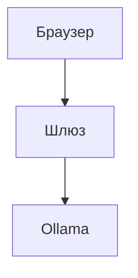

# Спецификация e2e

Документ для проверки превью: **жирный**, *курсив*, `код` и [ссылка на итоги](#итоги).

## Таблица

| Поле | Тип |
|------|-----|
| id | uuid |
| text | text |

## Задачи

- [x] превью
- [ ] вопросы

## Код

```python
def replace_tail(start: int) -> None:
    print("FOR UPDATE")
```

## Диаграмма



## Формулы

Энергия $E = mc^2$ и интеграл:

$$
\int_0^1 x^2\,dx = \frac{1}{3}
$$

## Итоги

Блокировка строки FOR UPDATE сериализует записи.[^1]

[^1]: Так работает replace_tail.
